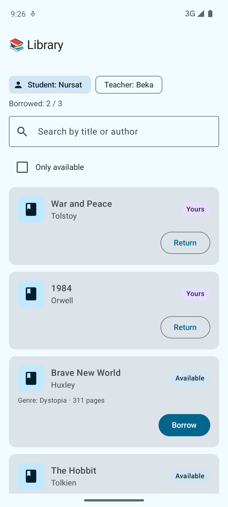
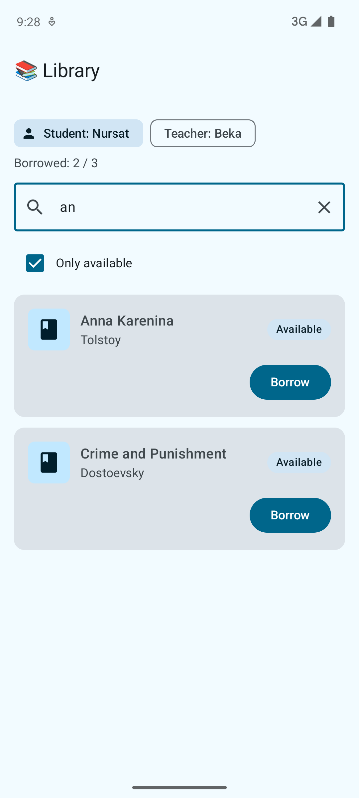
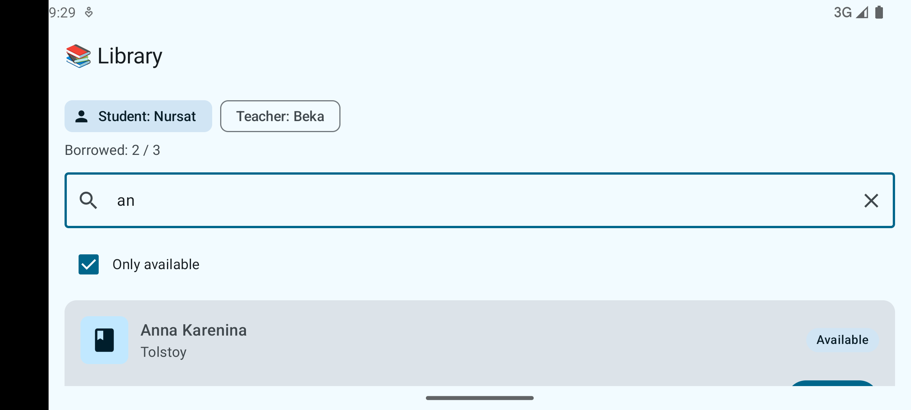

# Library App

An Android app for a small library, built with Kotlin, Jetpack Compose and ViewModel. It continues HW1: the `Book`, `User`, `BorrowResult` and `Library` classes from the console app are reused as the app's model layer.

A student or a teacher can browse the catalog, search and filter books, borrow books up to their personal limit and return them.

## Features

- **Book catalog** loaded asynchronously (a coroutine in the ViewModel simulates a network request).
- **User switch:** act as a student (limit 3 books) or a teacher (limit 10 books).
- **Borrow and return books.** Each book shows its status: *Available*, *Taken* or *Yours*.
- **Search** by title or author.
- **Filter** to show only available books.
- **Feedback messages** in a Snackbar for every action, e.g. *Limit reached (3 books)*.
- **Expandable book cards** that show genre and page count.

## How to run

1. Clone the repository and open the `LibraryApp` folder in Android Studio.
2. Wait for the Gradle sync to finish.
3. Start an emulator (API 26+) or connect a device.
4. Click **Run ▶**.

## Screenshots

| Catalog | Search and filter | After rotation |
|---|---|---|
|  |  |  |

## Project structure

```
app/src/main/java/com/example/libraryapp/
├── MainActivity.kt          Entry point, shows LibraryScreen
├── model/                   Logic from HW1 (no Android code)
│   ├── Book.kt
│   ├── User.kt              Student and Teacher with different limits
│   ├── BorrowResult.kt      Sealed class with the result of borrowing
│   └── Library.kt
├── viewmodel/
│   └── LibraryViewModel.kt  Screen state and actions
└── ui/
    ├── LibraryScreen.kt     The screen, connects components to the ViewModel
    └── components/          Reusable composables
```

## Where the requirements are demonstrated

| Requirement | Where |
|---|---|
| Material 3 and consistent styling | `Scaffold`, `TopAppBar`, `Card`, `FilterChip`, `Snackbar`; all colors come from `MaterialTheme` |
| Reusable composables | `BookCard`, `StatusBadge`, `BookSearchField`, `AvailabilityFilter`, `UserSelector` |
| `Row`, `Column`, `Box` | `BookCard`, `StatusBadge`, `UserSelector`, loading state in `LibraryScreen` |
| `LazyColumn`, `Card`, `Text`, `Image` | Book list in `LibraryScreen`, `BookCard` with a book image |
| User interactions | Borrow, return, search, filter, switch user |
| Input components | `OutlinedTextField`, `Button`, `OutlinedButton`, `Checkbox`, `FilterChip` |
| ViewModel | `LibraryViewModel` holds the catalog, borrowed books and the current user |
| UI separated from state | Components receive data and callbacks only; all logic is in `LibraryViewModel` and `model/` |

## State and Activity recreation

The screen uses all three kinds of state. Rotating the device recreates the Activity, and each kind behaves differently:

| State | Stored in | After rotation |
|---|---|---|
| Borrowed books, current user, catalog | `ViewModel` | Kept: the ViewModel outlives the Activity |
| Search text, "Only available" checkbox | `rememberSaveable` | Kept: saved to the Bundle and restored |
| Expanded book card | `remember` | Lost: cards collapse after rotation |

**To see it:** borrow a book, type a search query, expand a card, then rotate the device. The borrowed book and the search stay, the card collapses.

- **`remember`** keeps a value across recompositions, but loses it when the Activity is recreated.
- **`rememberSaveable`** also saves the value to the Bundle, so it survives rotation and process death. It is meant for small, simple UI values.
- **`ViewModel`** survives rotation and holds screen data and logic of any size, but is cleared when the user leaves the screen or the process is killed.
