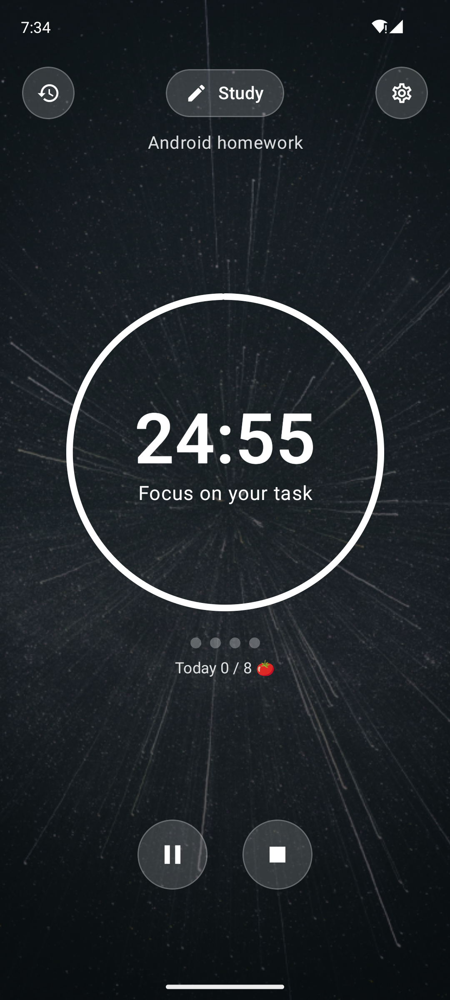
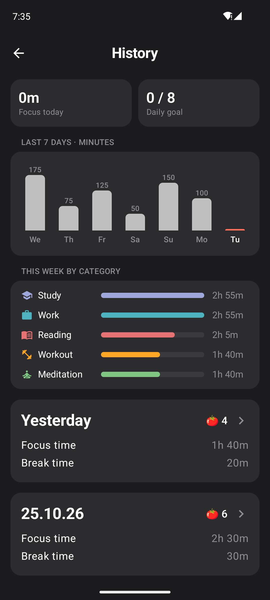
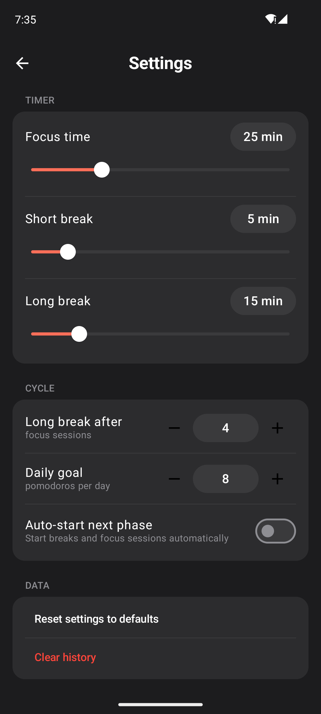

# Pomodoro Focus

An Android focus timer built with Kotlin and Jetpack Compose. It uses the Pomodoro technique: work for 25 minutes, take a 5-minute break, and after four focus sessions take a longer break. Every session is saved with its category and task, so the History screen shows where your focused time actually went.

## Screenshots

| Timer | History | Settings |
|---|---|---|
|  |  |  |

## Features

- **Pomodoro cycle.** Focus → short break → focus … and a long break after every 4 focus sessions. Dots under the timer show progress through the cycle. Start, pause, stop, and skip a break.
- **Focus categories.** Work, Study, Workout, Reading, Meditation, Others. Each category has its own background photo. You can also write what you are working on.
- **History and statistics.** Today's focus time and daily goal, a chart of focus minutes for the last 7 days, time per category this week, and a card for every day. Tapping a day opens its details with every session in order.
- **Settings.** Focus, short break and long break length, how many sessions before a long break, daily goal, and auto-start of the next phase. Changes apply to the timer immediately.

## How to run

1. Clone the repository and open the `PomodoroApp` folder in Android Studio.
2. Wait for the Gradle sync to finish.
3. Start an emulator (API 26+) or connect a device.
4. Click **Run ▶**.

Unit tests: right-click `app/src/test/.../PomodoroLogicTest.kt` → **Run**.

> History is kept in memory for now. On first launch it contains sample sessions for the past week, so the statistics are not empty. They can be removed with **Settings → Clear history**.

## Screens and navigation

```
Timer (start screen)
 ├─► Settings
 └─► History ─► Day Details (route "day/{date}")
```

Navigation Compose with a `NavHost`. Routes are defined in a sealed class `Screen`. Day Details receives the date as a route argument and reads it from `SavedStateHandle`. Back arrow and the system Back button return through the back stack.

## Project structure

```
app/src/main/java/com/example/pomodoroapp/
├── model/       Data classes and pure logic: FocusSession, TimerSettings,
│                TimerStatus (sealed), nextPhase(), statistics functions
├── data/        PomodoroRepository: settings and history as StateFlow
├── viewmodel/   TimerViewModel, HistoryViewModel, SettingsViewModel, DayDetailsViewModel
└── ui/
    ├── navigation/  NavHost and routes
    ├── timer/       Timer screen and category bottom sheet
    ├── history/     History screen
    ├── day/         Day details screen
    ├── settings/    Settings screen
    ├── components/  Reusable composables
    └── theme/       Colors and Material 3 theme
```

## Where the requirements are demonstrated

| Requirement | Where |
|---|---|
| 3+ screens with Navigation Compose | Timer, Settings, History, Day Details; route with an argument; back stack |
| 3+ meaningful features | Pomodoro cycle, categories with tasks, history and statistics, settings |
| Material 3, reusable components, consistent styling | `TimerRing`, `GlassIconButton`, `GlassChip`, `CycleDots`, `CategoryTile`, `SectionCard`, `SliderSettingRow`, `StepperSettingRow`, `WeeklyChart`, `SessionRow`, `DayCard`, `ScreenTopBar`; one dark color scheme |
| User input and events | Start / pause / stop / skip, category selection, task `TextField`, sliders, steppers, switch, confirmation dialogs |
| `remember` / `rememberSaveable` | `rememberSaveable` keeps the category sheet and confirmation dialogs open after rotation; `rememberNavController`, `rememberScrollState`, `rememberModalBottomSheetState` |
| State hoisting | Every screen is split into a stateful `XxxScreen` (ViewModel) and a stateless `XxxContent`; components take a value and an `onValueChange` lambda |
| ViewModel + StateFlow | Each ViewModel exposes `StateFlow<UiState>` built with `combine(...).stateIn(...)` |
| Lifecycle-aware collection | `collectAsStateWithLifecycle()` on every screen |
| Separation of UI, logic and state | `model/` has no Android code, `data/` owns the data, ViewModels prepare screen state, UI only draws |
| Kotlin classes, collections, coroutines | `sealed interface TimerStatus`, enums, data classes; `groupBy`, `sumOf`, `count`, `filter`, `map`; the timer is a coroutine in `viewModelScope` |
| Configuration changes | The timer keeps running after rotation (state lives in the ViewModel); the timer screen switches to a side-by-side layout in landscape |

## How the timer works

When the timer starts, it saves the moment it should end (`SystemClock.elapsedRealtime()` + remaining time) instead of counting seconds down. A coroutine updates the remaining time every 200 ms, so the timer stays accurate even if an update is late, and it is not affected by changing the phone's clock. When a phase ends, the session is saved to the repository and `nextPhase()` decides whether a short break, a long break or focus comes next.
